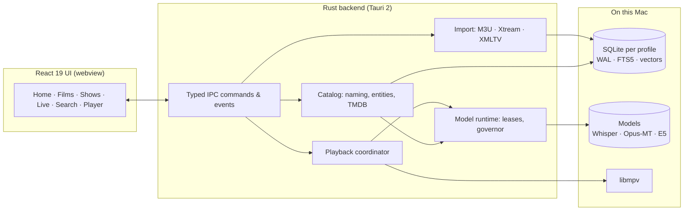

<div align="center">

# Nova

**A local-first IPTV player for macOS, with on-device AI for captions, translation and search.**

Bring your own M3U or Xtream playlist. Nova turns it into a cinematic library of films, shows and
live channels, then makes everything in it understandable: speech becomes timed captions,
captions become English, French or Arabic, and search understands what you mean, not just the
words you typed. All of it runs on your Mac. Nothing is sent to a cloud service.


[Features](#features) · [Getting started](#getting-started) · [User guide](docs/guides/user-guide.md) ·
[Architecture](docs/architecture/overview.md) · [Docs](docs/README.md) ·
[Roadmap](docs/roadmap.md) · [Contributing](CONTRIBUTING.md)


</div>

---

## Why Nova

IPTV playlists are huge, messy and provider-shaped: tens of thousands of rows with names like
`FR| Inception (2010) 4K`, duplicated across groups, with no artwork, no subtitles and no idea
what language anyone is speaking. Nova's goal is a player that feels like a premium streaming
service on top of that mess, without handing your viewing habits or credentials to anyone.

- **Local-first.** Your library, history and AI models live on your Mac. Provider URLs and
  credentials never reach the UI layer or the AI models.
- **Fast at real scale.** Built and measured on a real ~42k-entry playlist: import completes in
  a couple of seconds, every screen's catalog queries take milliseconds, and the interface runs
  at 120 Hz on ProMotion displays.
- **Intelligent, not dependent on intelligence.** Every AI feature degrades honestly. If a model
  is missing, disabled or fails, playback, browsing and exact search keep working.

## Features

### A real library from a raw playlist

| | |
|---|---|
|  |  |
| **Films and shows.** Titles are cleaned, de-duplicated across sources and matched to TMDB (optional, your own key) for artwork, cast, ratings, collections and related titles. | **Detail pages.** Per-title versions, audio languages confirmed from the actual streams, resume points and "Up next" for series. |
|  |  |
| **Shows that remember.** Continue each series at the right episode, see what airs this week, and let autoplay move to the next episode. | **Search that understands.** Hybrid search blends exact (FTS5) and on-device semantic matching across films, shows and channels, and falls back to exact matching if the model is unavailable. |
|  |  |
| **Live TV, untangled.** Dozens of provider entries for one channel become a single family, with editions by language, region and quality. | **A real programme guide.** XMLTV data on a timeline, now and next on every card, and a variant picker that remembers the stream that works. |

### On-device intelligence


- **Captions for anything.** Whisper large-v3-turbo transcribes the audio of whatever you are
  watching into word-timed captions, using the Apple Neural Engine (Core ML) with Metal as a
  fallback. Captions follow seeks and resume from where you are.
- **Translated captions.** Captions in English, French and Arabic, translated locally by
  Opus-MT models on ONNX Runtime, with French ↔ Arabic routed through English. Show the
  translation alone or under the original. Arabic renders right-to-left.
- **Dialogue search.** Search inside a film's dialogue and jump straight to the moment.
- **Semantic catalog search.** Multilingual E5 embeddings let "space thriller with a twist" find
  films whose titles never say so.
- **Model manager.** Download, verify, enable, disable and unload models from Settings, or keep
  them on an external SSD. Every pinned file is checked against a SHA-256 checksum.

See **[On-device intelligence](docs/features/intelligence.md)** for how each capability works,
what it costs, and how it fails.

### Native playback

- Embedded **libmpv** rendering (CAOpenGLLayer) for wide codec and container support.
- Rust-owned playback state: resume, progress, completion, next episode and recovery to another
  source when a stream fails.
- Audio-track selection, caption styling, AirPlay, picture-in-picture and lifecycle handling
  across sleep and wake.
- Full keyboard control: see the [shortcuts](docs/guides/user-guide.md#keyboard-shortcuts).

### Smooth at 120 Hz

Nova lifts WebKit's default 60 fps cap on ProMotion displays, and every performance claim is
measured on a real 42k-entry playlist. A built-in frame-rate overlay (**⌘⌥F**) records each scroll,
and fixes are driven by its reports: a Live guide page went from 73 s to 2 ms, a channel switch
from 5.5 s to under 1 ms. See [Performance engineering](docs/architecture/performance.md).

## Getting started

> **Requirements:** macOS 14+ on Apple Silicon. Intel Macs, Windows and Linux are not supported
> yet. Nova is alpha software: expect rough edges, and read the
> [status page](docs/nova-implementation-status.md) for what is verified.

```bash
# 1. Clone
git clone https://github.com/YoussefSah05/nova.git && cd nova

# 2. Native media libraries (playback and audio extraction)
brew install mpv ffmpeg

# 3. Pinned toolchains, packages and Nova's private Whisper runtime (needs mise)
bash scripts/bootstrap.sh

# 4. Run
just dev        # development window with hot reload
just build      # release Nova.app and .dmg
```

Then add a playlist (M3U URL, M3U file or Xtream credentials), and download the models you want
from **Settings → Models**: captions (~500 MB), translation (~450 MB) and catalog
search (~120 MB). Browsing and playback need no models.

The full walkthrough, including troubleshooting, is in
**[Getting started](docs/guides/getting-started.md)**.

## Architecture at a glance



Read the **[architecture overview](docs/architecture/overview.md)** for the process model, the
crate map, data ownership and the intelligence pipeline.

## Project layout

```
nova/
├── apps/desktop/        Tauri app: React UI (src/) and Rust backend (src-tauri/)
├── crates/
│   ├── core/            Domain types, naming, live identity, model manifest
│   ├── storage/         SQLite repositories and migrations (app + per-profile)
│   ├── m3u/ xtream/ epg/   Provider parsers and clients
│   ├── mpv-player/      libmpv playback engine
│   ├── transcribe/      Whisper (CLI windows + resident streaming worker)
│   ├── translate/       Opus-MT translation on ONNX Runtime
│   ├── enrich/          Embeddings, de-duplication, genres, TMDB
│   ├── search/          FTS5 query building
│   ├── artwork/ media/ hls-proxy/ jobs/   Supporting services
│   └── catalog-*/       Next-generation catalog pipeline (not yet wired in)
├── tools/               Benchmarks (ai-bench) and provider fixtures
├── docs/                Architecture, features, guides, ADRs, contracts
└── scripts/             Bootstrap and native installers
```

## Documentation

| | |
|---|---|
| [Documentation index](docs/README.md) | Everything, organised by audience |
| [Getting started](docs/guides/getting-started.md) | Install, first playlist, models, troubleshooting |
| [User guide](docs/guides/user-guide.md) | Every screen, the player, captions, settings, keyboard shortcuts |
| [FAQ](docs/FAQ.md) | Playlists, privacy, supported Macs, 120 Hz, captions |
| [Architecture overview](docs/architecture/overview.md) | How Nova fits together |
| [On-device intelligence](docs/features/intelligence.md) | Captions, translation, search, model management |
| [Performance engineering](docs/architecture/performance.md) | Budgets, measurement tools, case studies |
| [Roadmap](docs/roadmap.md) and [status](docs/nova-implementation-status.md) | Where Nova is going, and what is verified |
| [Contributing](CONTRIBUTING.md) | Workflow, conventions and checks |

## Privacy

Nova makes network requests only to your playlist provider, to TMDB when you enable it with your
own key, and to Hugging Face/GitHub when you choose to download a model. There is no telemetry
and no account. Provider credentials stay in the Rust backend: the UI receives opaque IDs, and
logs and errors reduce URLs to `scheme://host`. See [SECURITY.md](SECURITY.md).

## Status and roadmap

Nova is **0.2.0-alpha**. Import, browsing, native playback, captions, translated captions and
hybrid search work and are exercised on a real large playlist. Next up:

- Live-channel captions (audio capture from the live player)
- **Ask Nova**: a ⌘K assistant with typed, validated intents
- "About this title" summaries from a local LLM
- Signed, notarised builds with a bundled media SDK

See the [roadmap](docs/roadmap.md); the [implementation status](docs/nova-implementation-status.md)
tracks every milestone against the [long-term architecture](docs/architecture/long-term-architecture.md).

## Community

- Questions: start with the [FAQ](docs/FAQ.md) and the [user guide](docs/guides/user-guide.md).
- Bugs and ideas: [open an issue](https://github.com/YoussefSah05/nova/issues/new/choose). Please
  never include playlist URLs or credentials.
- Security: report privately, see [SECURITY.md](SECURITY.md).
- Contributing: read [CONTRIBUTING.md](CONTRIBUTING.md) and the
  [code of conduct](CODE_OF_CONDUCT.md).

## Acknowledgements

Nova stands on [Tauri](https://tauri.app), [mpv](https://mpv.io),
[whisper.cpp](https://github.com/ggml-org/whisper.cpp),
[ONNX Runtime](https://onnxruntime.ai), [Opus-MT](https://github.com/Helsinki-NLP/Opus-MT),
[multilingual-E5](https://huggingface.co/intfloat/multilingual-e5-small),
[SQLite](https://sqlite.org) and [TMDB](https://www.themoviedb.org). This product uses the TMDB
API but is not endorsed or certified by TMDB.

## License

[MIT](LICENSE). Model weights keep their own licences (Whisper: MIT; Opus-MT: CC-BY-4.0;
multilingual-E5: MIT), shown in Settings.
