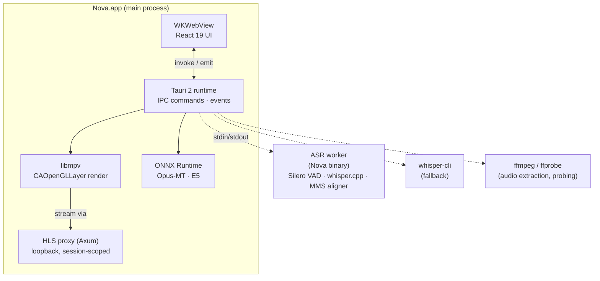
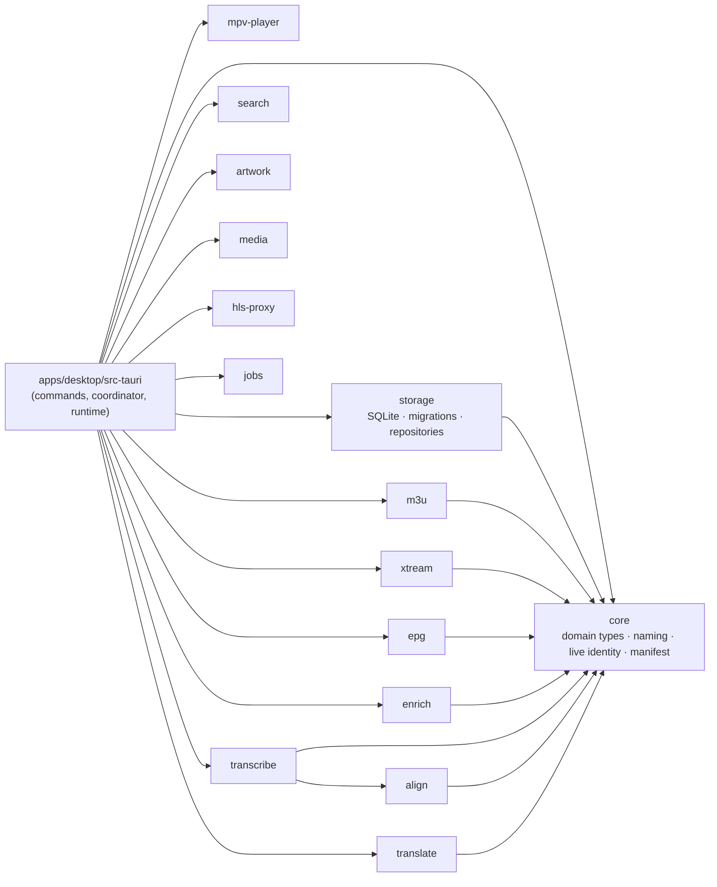
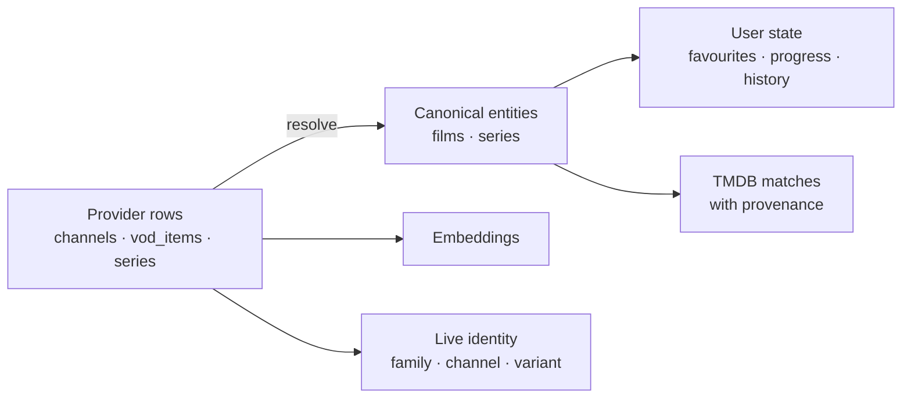
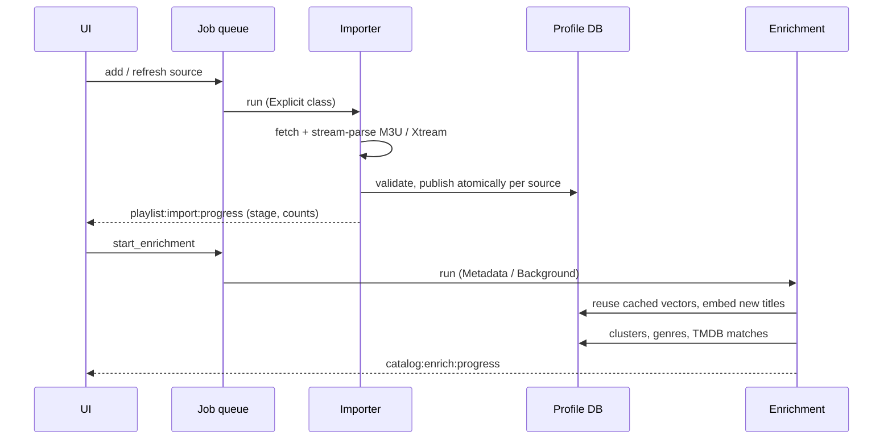

# Architecture overview

This is the readable tour of how Nova works today. The long-term target, and the milestone
process used to get there, is the
[master bootstrap](long-term-architecture.md); accepted decisions are recorded as
[ADRs](../adr/). When this page and the code disagree, the code wins.

## Design principles

1. **Rust owns truth; React owns presentation.** Playback state, user state, catalog identity
   and every model decision live in the Rust backend. The UI renders what it is told and sends
   typed intents back.
2. **Local-first and secret-free.** Provider URLs and credentials never cross the IPC boundary.
   The UI sees opaque IDs and a loopback stream locator.
3. **Deterministic first, intelligence second.** Exact search, browsing and playback never depend
   on a model. AI adds to them and degrades honestly when unavailable.
4. **Bounded everything.** Downloads, queues, batches and memory have explicit limits, and
   background work yields to playback.

## Processes

- The **main process** hosts the webview, every IPC command, the stream proxy and libmpv.
  Translation and embedding models run in-process on a single shared ONNX Runtime.
- **Speech recognition** runs out of process. A resident worker (the Nova binary in worker mode)
  keeps whisper.cpp loaded, so a crash in native inference cannot take the player down
  ([ADR 0011](../adr/0011-resident-asr-worker-process.md)). Caption windows extracted by FFmpeg
  are decoded there, with a timing stage around Whisper: voice activity detection before it and
  CTC forced alignment of every word after it
  ([ADR 0014](../adr/0014-caption-timing-and-cold-start.md)). `whisper-cli` is the fallback
  when the worker cannot start.
- **Captions start before playback.** Opening a title's playback menu warms the worker and
  transcribes the opening from the resume point; the player's caption session adopts that
  work instead of starting over.

## Crate map

| Crate | Responsibility |
|---|---|
| `core` | Domain types shared everywhere: catalog entities, title naming and cleaning, live-channel identity, the model manifest and engine traits. No I/O. |
| `storage` | `app.db` (models, profiles, settings) plus one SQLite database per profile (catalog, user state, transcripts, vectors). WAL mode, FTS5, compile-time checked queries. |
| `m3u`, `xtream`, `epg` | Streaming provider parsers and clients: M3U/M3U8, the Xtream Codes JSON API, XMLTV guides. |
| `mpv-player` | libmpv engine: open, seek, tracks, state snapshots, and macOS embedding. |
| `transcribe` | Whisper: the resident worker (caption windows and live streaming), the CLI fallback, model layout. |
| `align` | Caption timing: Silero voice activity detection, MMS CTC forced alignment and the refine pass that combines them with Whisper's words. Runs inside the ASR worker. |
| `translate` | Marian (Opus-MT) encoder-decoder translation on ONNX Runtime. |
| `enrich` | E5 embeddings, duplicate clustering, genre classification and TMDB matching. |
| `search` | FTS5 query construction for catalog and transcript search. |
| `artwork`, `media`, `hls-proxy`, `jobs` | Artwork cache, FFmpeg wrapper, the loopback stream proxy, the job scheduler. |
| `catalog-ingest`, `catalog-reasoner` | The next-generation catalog pipeline (lossless snapshots, bounded local reasoning). Built and tested, not yet wired into the app. |

## Data model and ownership

- **Provider rows** are what a playlist says. A refresh replaces them, so nothing durable should
  hang off a provider row ID.
- **Canonical entities** (`mov-…`, series entities) own user state and TMDB matches, so a
  favourite or a resume point survives a provider renaming or reordering its catalog.
- **Live identity** groups channel rows into families (all editions of one channel) and
  variants (language, region, quality, codec) without ever treating two streams as
  interchangeable.
- **Embeddings** are stored per row and reused across refreshes by exact text, so an
  unchanged title is never embedded twice.

Every profile is a separate database, so profiles are isolated and can be recovered or copied
independently.

## A playlist import

Imports are persisted jobs: they survive restarts, de-duplicate, can be cancelled, and report
progress as typed events. Enrichment waits while you watch something.

## Playback

The **playback coordinator** is an ordered actor in Rust. libmpv wakeups only poke it; it takes
its own snapshot of engine state and decides resume, progress writes, completion and the next
episode. A webview reload, an unmount race or a stale callback therefore cannot lose progress.
When a stream fails, bounded recovery retries the same source once, then moves to other sources
for the same title, and records per-source health.

## Intelligence and the resource governor

All model work goes through one **model runtime** and one **resource governor**:

- The runtime discovers models from a bundled, validated manifest. It loads them lazily, hands
  out **leases** so nothing is unloaded mid-inference, evicts idle models under a residency
  budget, and respects per-model enable/disable.
- The governor admits work by class, in fixed priority order: playback, realtime
  (captions and translation), interactive (search), explicit (import), metadata, background,
  maintenance. While anything is playing, metadata, background and maintenance work is
  suspended.

The capabilities themselves are described in
[On-device intelligence](../features/intelligence.md).

## Performance

Interface work is budgeted for 120 Hz (8.3 ms per frame), and catalog queries for milliseconds on
a real 42k-entry playlist. The tools, measurements and rules are in
[Performance engineering](performance.md); why the interface is web-based at all is
[ADR 0013](../adr/0013-web-ui-on-tauri-with-native-video.md).

## The IPC boundary

Commands return `Result<T, ApiError>` with a typed error enum; events use colon-namespaced names
(`playlist:import:progress`, `transcription:cues`, `model:download:progress`). Payload types are
generated from Rust with ts-rs into `apps/desktop/src/types/generated/`, so the two sides cannot
drift. The full list is in the [IPC contract](../ipc-contract.md).
