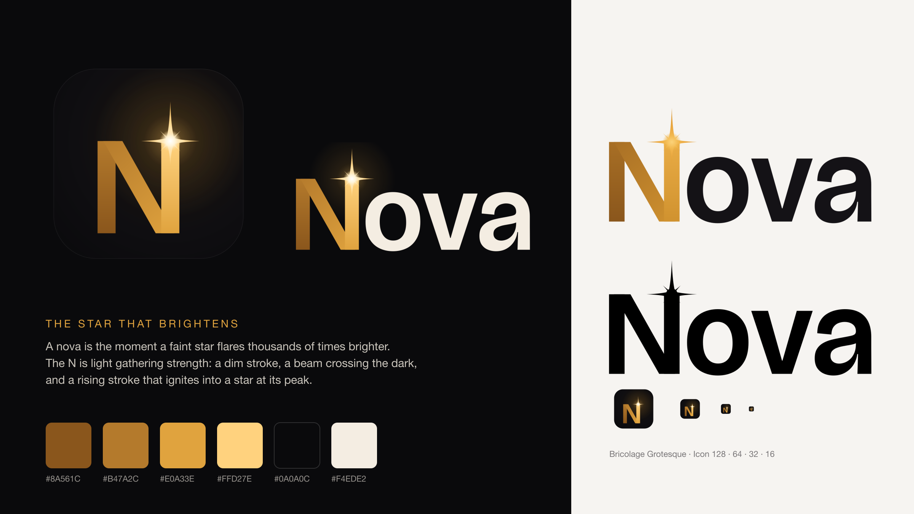
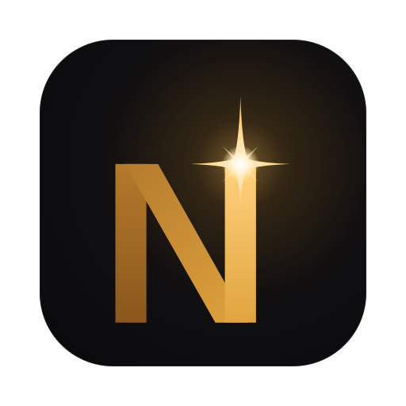

# Nova brand

## The story: the star that brightens

A **nova** is the moment a faint star suddenly flares, shining thousands of times brighter than
before, so bright that for a few nights it looks like a new star has been born. That is what
Nova does to a playlist. Tens of thousands of dim, scattered provider entries become a bright,
organised cinema, and everything in it becomes understandable: speech becomes captions, captions
cross languages, and search understands meaning.

The logo tells that story in a single letter.

## The mark

The **N** is drawn as light gathering strength, in three planes:

1. **The left stroke is dim amber.** This is the raw playlist: present, but not yet lit.
2. **The diagonal is the beam.** It crosses the dark the way a projector's light crosses a
   cinema, carrying the light from one side to the other.
3. **The right stroke rises to full gold**, and at its peak the light **ignites into a star**:
   the nova.

The star is drawn the way real stars appear through a telescope: four long diffraction spikes,
four short ones and a white-hot core. It sits exactly on the axis of the rising stroke, so the
star belongs to the letter rather than decorating it. The three planes meet at slight angles of
brightness, like a strip of film turning as it catches the light.

The letterforms are **Bricolage Grotesque**, Nova's display typeface, so the logo and the app
speak with one voice. The gold is Nova's accent, and the dark tile is the cinema before the
lights come up.

## Versions

| File | Use |
|---|---|
| `nova-icon.svg` | App icon, 128 px and larger |
| `nova-icon-small.svg` | App icon at 64 px and smaller (bolder rays that survive tiny sizes) |
| `nova-lockup-dark.svg` | Primary logo on dark backgrounds |
| `nova-lockup-light.svg` | Logo on light backgrounds (deeper gold star, dark lettering) |
| `nova-lockup-mono-white.svg`, `nova-lockup-mono-black.svg` | Single-colour use: embossing, watermarks, print |
| `nova-symbol-dark.svg`, `nova-symbol-light.svg` | The N and star alone, without a tile |

All files are in [`assets/brand/`](assets/brand/); PNG exports are in
[`assets/brand/png/`](assets/brand/png/).

## Colour

| Role | Value |
|---|---|
| Dim plane | `#8a561c` → `#b47a2c` |
| Beam | `#b47a2c` → `#e0a33e` |
| Bright plane | `#e0a33e` → `#ffd27e` |
| Star core | `#ffffff` → `#ffd98f` |
| Nova accent | `#e0a33e` |
| Cinema dark | `#0a0a0c` |
| Wordmark on dark | `#f4ede2` |
| Wordmark on light | `#141216` |

## Usage

- **Clear space:** keep at least the height of the star's upper ray free around the logo.
- **Minimum size:** lockup 96 px wide on screen; below 64 px use the small icon.
- **Keep the star on the N.** Never move it, resize it on its own, or add it to other letters.
- **Don't** recolour the planes, outline the logo, add effects, or set "Nova" in another typeface.
- **On photographs**, use the single-colour version over a calm, dark area.

## Rebuilding the logo

The logo is generated, not hand-drawn. `tools/brand/nova_logo.py` builds every version from the
outlines of Bricolage Grotesque (weight 620) and the star geometry; see
[`tools/brand/README.md`](../tools/brand/README.md).

Bricolage Grotesque is © The Bricolage Grotesque Project Authors, licensed under the SIL Open
Font License 1.1.
