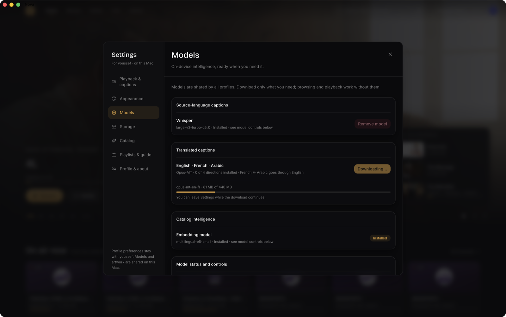
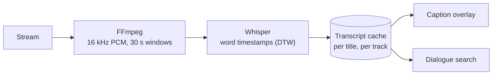
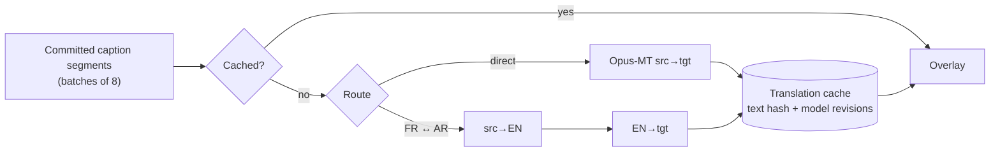

# On-device intelligence

Nova's AI features run entirely on your Mac. This page explains what each one does, which model
powers it, what it costs, and what happens when it cannot run.

## Capabilities

| Capability | Model | Runs on | Download |
|---|---|---|---|
| Captions (speech → timed text) | Whisper large-v3-turbo, q5_0 | Apple Neural Engine (Core ML), Metal fallback | ~500 MB |
| Translated captions (EN · FR · AR) | Opus-MT, four directions, int8 | ONNX Runtime (CPU) | ~450 MB |
| Semantic catalog search, genres, de-duplication | multilingual-E5-small | ONNX Runtime (CPU) | ~120 MB |
| Dialogue search within a title | Whisper transcript + FTS5 / E5 | SQLite + ONNX Runtime | — |

Nothing downloads automatically. Get models from **Settings → Models**, or point Nova
at an external folder (for example an SSD) that already holds them.

## Captions

- Audio is extracted around the playhead in **30-second windows with 3 seconds of overlap**,
  then stitched by word timing. Captions follow seeks and start from the resume point.
- Transcripts are cached per title and audio track, so reopening a film is instant.
- Silent openings do not lock the language guess; failed windows are retried (three
  cancellable attempts) rather than silently skipped.
- **Measured:** on real French and Arabic speech, the first Whisper invocation (Core ML model
  compilation) took ~40 s and later invocations ~1.6 s per window on an Apple Silicon Mac.

## Translated captions

- Modes: **Translation** alone, or **Source + translation**. Press `C` in the player to cycle.
- Only committed (final) caption segments are translated, eight at a time, so text never jumps.
- French ↔ Arabic has no direct model; it pivots through English, holding one model lease at
  a time.
- Each cached translation records the source text's SHA-256, the language pair and the exact
  model revisions, so changing a model never serves stale text.
- **Measured** on the installed models:

  | Direction | Input | Output |
  |---|---|---|
  | FR → EN | Il fait beau aujourd'hui. | It's beautiful today. |
  | AR → EN | الطقس جميل اليوم. | The weather is beautiful today. |
  | FR → AR (pivot) | Bonsoir et bienvenue. | مساء الخير ومرحباً بك |

## Search

- **Hybrid retrieval.** Every query runs exact FTS5 search (with aliases and original titles)
  and, if the embedding model is available, a semantic leg over E5 vectors; results are merged.
  If the semantic leg fails or the model is disabled, you still get exact results.
- **Embeddings are reused across refreshes.** A refresh replaces provider rows, but Nova keys
  vectors by model and exact text. On a real ~37k-title playlist, re-embedding cost about
  3 minutes of CPU per refresh (202 titles/s); with the cache an unchanged refresh takes under
  a second and never loads the model.
- **Dialogue search.** In the player's transcript panel, search what was said and jump to it.

## Model management

- **Pinned and verified.** Each downloadable model in the bundled manifest names an exact
  upstream revision and every file's size and SHA-256. Files stream to a temporary name, are
  hashed while writing, and only take their real name on an exact match. A verified directory
  gets a marker, so later status checks are cheap.
- **Runtime leases.** A model in use cannot be unloaded, disabled or reinstalled underneath its
  user. Idle models are released under a residency budget.
- **Enable / disable / unload.** Per model, app-wide, persistent. Disabling never deletes data.
- **External libraries.** Models can live in a folder you grant access to; if the drive
  disconnects, dependent features become unavailable and come back on reconnect.

## When things fail

| Situation | What you see |
|---|---|
| Model not downloaded | The feature offers a download; everything else works |
| Model disabled | Feature unavailable, with a link to Settings |
| External drive offline | Feature unavailable until it reconnects; settings are kept |
| Corrupt or modified files | Marked for repair; never loaded |
| Captions fail mid-film | Playback continues; the caption menu shows the stage and a retry |
| Translation fails | Source captions stay on screen |
| Semantic search unavailable | Exact search results only |
| Something is playing | Background indexing waits until playback ends |

## Privacy

Models only ever see media audio, caption text and catalog titles. They never receive provider
URLs or credentials, and no prompt, transcript or vector leaves your Mac.

## Roadmap

- Captions for live channels (audio capture from the live player)
- A Command-K assistant that turns requests into typed, validated actions
- "About this title" summaries from a local LLM
- More translation directions as benchmarks justify them
