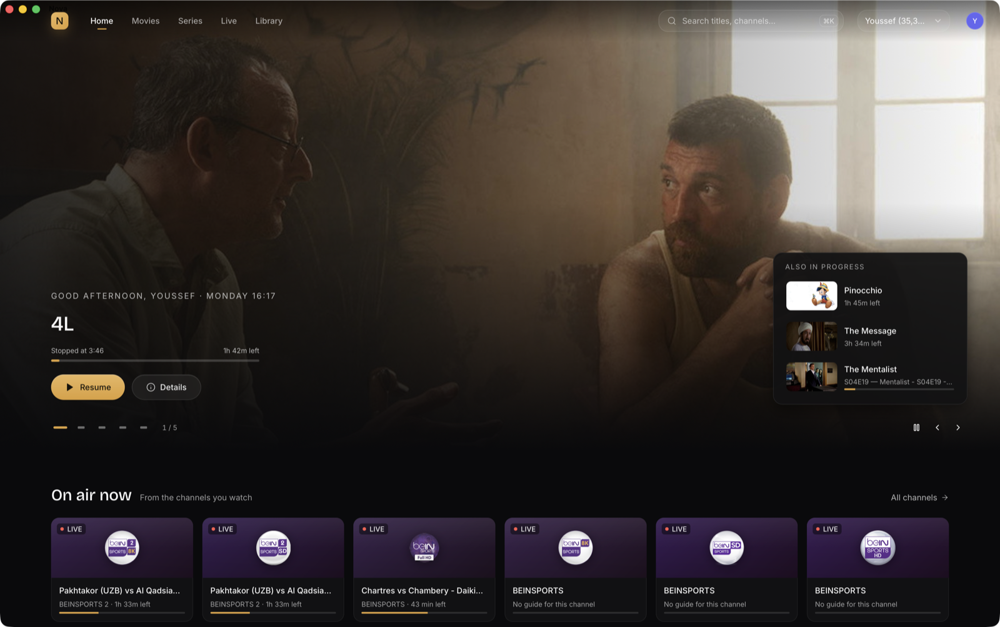
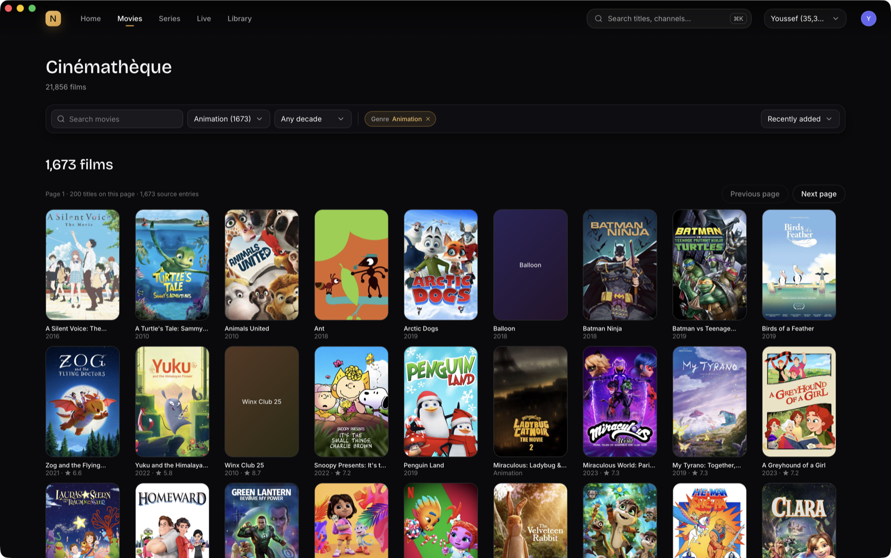
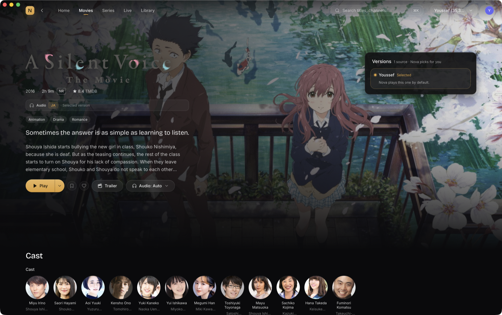
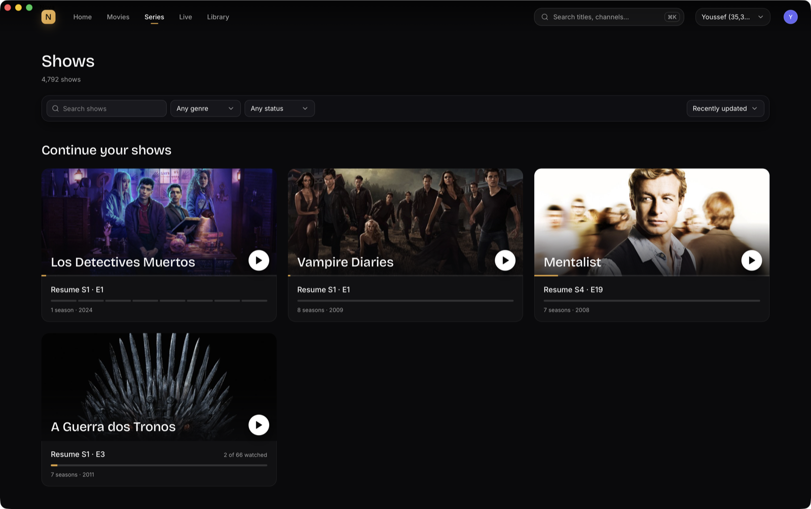
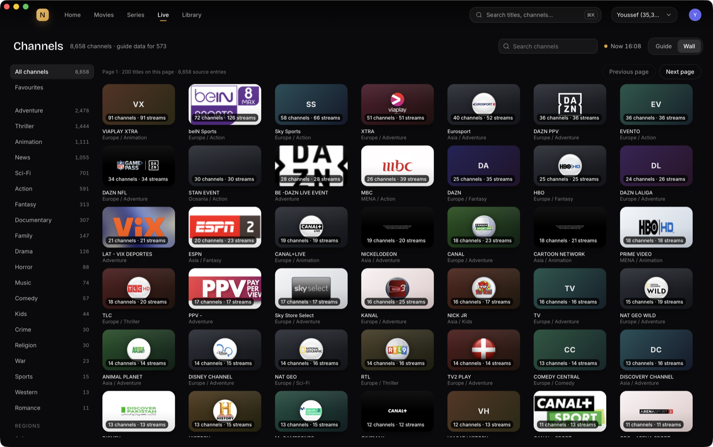
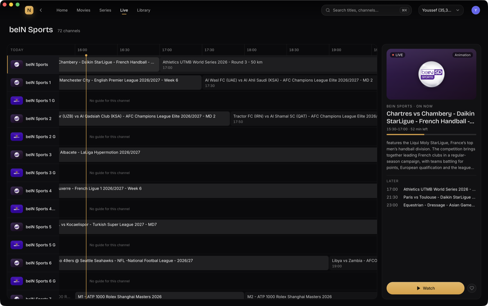
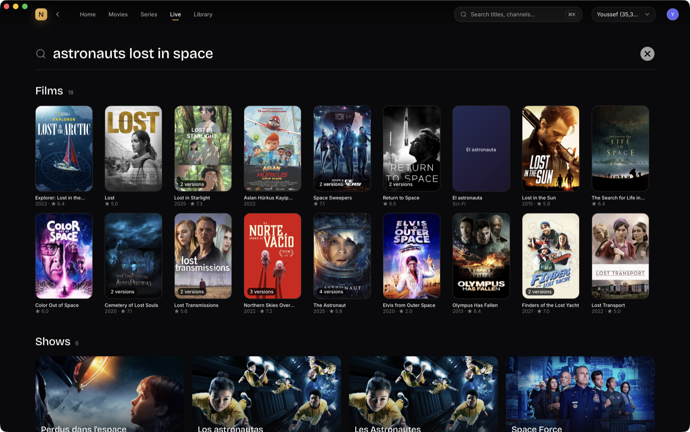

# User guide

A tour of Nova for people who watch with it. New here? Start with
[Getting started](getting-started.md) to install Nova and add a playlist.

- [Profiles](#profiles)
- [Home](#home)
- [Movies](#movies)
- [Shows](#shows)
- [Live TV](#live-tv)
- [Search](#search)
- [Library](#library)
- [The player](#the-player)
- [Captions and translation](#captions-and-translation)
- [Settings](#settings)
- [Keyboard shortcuts](#keyboard-shortcuts)

## Profiles

Each profile has its own playlists, history, favourites, watchlist and preferences, stored in its
own database. Models and the artwork cache are shared by every profile on the Mac. Choose
**Manage profiles** on the launch screen to rename or remove one.

## Home

Home picks up where you left off: the title you were watching (with its progress), other
titles in progress, and **On air now** from the channels you watch, with the programme currently
showing. Further down are recommendations from your own library and what is new in it.

## Movies

The **Cinémathèque** lists every film in your playlists, cleaned up and grouped:

- the same film offered several times (different qualities, languages or groups) appears once,
  with a **versions** badge;
- filter by genre and decade, sort by **Recently added**, **A–Z**, **Newest first** or **Best rated**,
  or search the list;
- **Collections** gathers the sagas and series of films you own.

Open a film to see its details, cast, ratings and related titles in your library.

On a detail page:

- **Play** (or **Resume**) starts the best available version; the arrow next to it offers
  caption choices for this viewing.
- **Versions** lists every source of the film; Nova picks one and you can choose another.
- **Audio** shows the languages actually present in the selected stream.
- Bookmark (watchlist) and heart (favourite) buttons, and **Trailer** when TMDB has one.

## Shows

**Continue your shows** resumes each series at the right episode, **This week** lists shows with
a new episode, and **All shows** browses everything. A show page lists seasons and episodes,
marks what you have watched and offers **Up next**. Autoplay moves to the next episode when one
ends (you can turn it off in Settings).

## Live TV

Providers often list the same channel dozens of times (per language, region and quality). Nova
groups them:

- **Wall** shows channel families, for example *beIN Sports · 72 channels · 126 streams*.
- **Guide** shows a timeline of what is on, with now and next, when the playlist or Settings
  provides an XMLTV guide.
- Filter by category or region, search channels, or show favourites only.

Opening a family lists its channels with their programmes. In the player, the variant picker
switches between versions of the same channel (language, region, quality). Nova remembers the
version that works for you and moves past one that keeps failing.

## Search

Press **⌘K** anywhere, type, and press **Return** for full results. Search finds films, shows and
channels by title (including original and alternative titles) and, with the catalog model
installed, by meaning: *astronauts lost in space* finds space-survival films whose titles never
say so. Without the model you still get exact matches.

## Library

Three views, **Watchlist**, **Favourites** and **History**, across films, shows and channels,
with a search over what you have saved.

## The player

Nova plays streams with mpv, so most codecs and containers work, including 4K and HDR streams.

- Your position is saved continuously; reopening a title resumes it.
- If a stream fails, Nova retries once, then tries another version of the same title.
- **Cinema mode** (`T`) dims everything except the picture; for live TV it adds a channel strip.
- Picture-in-picture (`P`) and AirPlay are available from the controls.
- **Audio** lists the stream's real audio tracks; untagged tracks are shown as *Unknown*.

## Captions and translation

Captions are made on your Mac from the audio of what you are watching. Install the models in
**Settings → Models** first.

| Mode | What you see |
|---|---|
| Off | No captions |
| Source | What is said, in the spoken language |
| Translation | Captions translated to English, French or Arabic |
| Source + translation | Both, the translation underneath |

Press `C` to cycle the modes, or use the **CC** menu to choose the target language and caption
style. The CC menu also shows what Nova is doing (extracting audio, waiting for the model,
recognising speech). The first window of a session takes longer while the speech model prepares;
later windows take a couple of seconds. If translation fails, the source captions stay on screen.

In the player, the transcript panel lets you search what was said and jump to that moment.

Captions currently work for films and episodes, not live channels.

## Settings

Open Settings from your profile menu (top right).

| Section | What you can change |
|---|---|
| Playback & captions | Autoplay next episode, playback route, default caption mode, preferred audio and subtitle languages, caption appearance |
| Appearance | Accent colour; **High refresh rate** (120 Hz on ProMotion displays, on by default) |
| Models | Download, verify, enable, disable or unload Whisper, translation and catalog models; external model folders |
| Storage | Artwork cache and transcript cache sizes, and clearing them |
| Catalog | Refresh catalog intelligence; optional TMDB metadata with your own API key; title language |
| Playlists & guide | Add, refresh, auto-refresh or remove playlists; XMLTV guide URLs and guide status |
| Profile & about | Profile name and colour; version information |

## Keyboard shortcuts

### Anywhere

| Keys | Action |
|---|---|
| `⌘K` | Search |
| `⌘1` to `⌘5` | Home, Movies, Shows, Live, Library |
| `⌘[` or `Esc` | Back |
| Mouse back button | Back |
| `⌘⌥F` | Frame-rate overlay (for measuring scroll smoothness) |

### In the player

| Keys | Action |
|---|---|
| `Space` or `K` | Play / pause |
| `←` / `→` | Back / forward 5 seconds |
| `J` / `L` | Back / forward 10 seconds |
| `↑` / `↓` | Volume up / down |
| `M` | Mute |
| `F` | Full screen |
| `C` | Cycle caption mode (films and episodes) |
| `T` | Cinema mode |
| `P` | Picture-in-picture |
| `0` to `9` | Jump to 0%–90% of the title |
| `,` / `.` | Previous / next frame while paused |
| `Esc` | Leave cinema mode, full screen, then the player |
